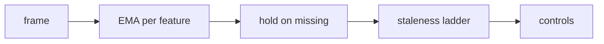
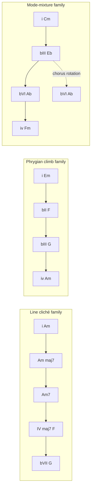
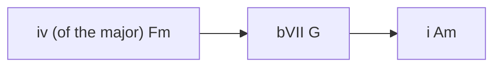

# The Chains of Margoth and the Wizards of SixthSense

An area of the site where live headbands play a gated-snare goth band — drums,
bass, chords — and the person in front of it improvises a lead over a chain of
chords that keeps deciding. Each sharer is a *wizard* pushing the chain; the chain
is the score, visible, and it never does anything a goth band wouldn't.

Confirmed: browser on the same page, same repo, all-synthesised audio, consent
given. Works with **one sharer** and with several; the single-sharer case is the
default, not a degraded one.

v3 supersedes v2 in one big way: the harmony engine is rebuilt from the five
progressions you named, and *pressure raises harmonic density inside a held chord
instead of chord-change frequency*. v2's model was jazz-minded — frequent changes
as difficulty — and it would have fought the genre.

---

## 1. Band and player

| | Who | Does |
|---|---|---|
| **Band** | generated, head-steered | drums, bass, chords. Fixed grammar, physiology only chooses among legal devices |
| **Player** | you | the lead: your rig (page as chart + clock), or the page's own synth lead via Web MIDI when there is no rig |

The player is why the chord display exists: the chain must be readable at a
glance, one bar ahead, like a punk band's chord sheet.

## 2. Signal conditioning

Every feature passes three stages before it can touch music
(`music/conditioner.js`, pure, testable):

| Feature | τ | Why |
|---|---|---|
| `motion` (imu accel deviation) | 0.25 s | drives fills, must feel immediate |
| `bands` per band/channel | 1.2 s | ~1 s reality, must not flicker |
| `alpha_share`, `asymmetry` | 1.5 s | harmony and lead controls |
| `arousal` | 3.0 s | a mood, not a twitch |
| `hr.bpm`, `rmssd` | 8.0 s | slow by nature |
| `optics` | 2.0 s | timbre only |

**Hold on missing**: a dropped frame keeps the last smoothed value and marks it
`held`. It never decays toward zero, and zero is never a musical value — that is
the whole `valid`-gate lesson from the api work, applied here.

**Staleness ladder** (per sharer, from `stale_s`): <1.5 s normal · 1.5–6 s held,
badge goes hollow · >6 s that wizard's votes fade to neutral and other wizards
absorb its parts · `leave` fades its parts over one bar.

**Baseline decay (the solo wizard).** A single sharer who takes the headband off
must not leave a frantic climb vamp looping forever, and it must not be a hard
cut to a different piece either. Past `DECAY_S = 10 s` of silence, `C` bleeds
toward `C_FLOOR = 0.1` with a 6 s time constant: the chain stops advancing, the
pad and lead drop out, and the band settles into a hypnotic **root vamp** —
kick, snare, hats, bass on the root, no harmony, no pedal — until the player
returns. On return, `C` recovers over ~3 s and the chain resumes from the chord
it is holding, so re-entry is never a jump. One wizard is the common case, not a
degraded one, so this path is tested like any other.

## 3. The chain

The chain is a graph. Nodes are **chord states** inside five **families**; edges
are legal moves. It is small on purpose — goth is a small language, and a small
language is what makes a chain legible on screen.

**Families as data** (`music/families.js`), each entry: degree path, qualities,
default harmonic rhythm, the devices it owns, and its "open" chord (the release):

| # | Source (harmonic reference only) | Path (degrees) | Signature device | Open chord |
|---|---|---|---|---|
| 1 | The Church — Under the Milky Way | `i → i(maj7) → i7 → IVmaj7 → bVII` | **line cliché**: the 7th descends chromatically inside a held root (G#→G→F), then breaks open | `IVmaj7` |
| 2 | Siouxsie — Spellbound | `i → bII → bIII → iv` | **phrygian stepwise climb** + sus4/sus2 in the upper voices; drone pedal holds the open strings | `bIII` |
| 3 | Depeche Mode — Enjoy the Silence | verse `i → bIII → bVI → iv`; chorus `i → bVI → bIII → bVII` | **section rotation**: same tonic, chorus leans on major chords for a cathedral lift | `bVI` |
| 4 | Peter Murphy — Cuts You Up | `i → bIII → bVII → IV` | **major IV lift** (D over A minor): the repeated loop that ends triumphant, flamenco accent | `IV` |
| 5 | Bowie — Starman | intro `IVmaj7 → Imaj7`; climb `bVI → bVII → I → II`; chorus `I → vi → IV → iv` | **maj7 suspension** (weightless, no resolution) then stepwise climb, then **IV→iv mixture** | `Imaj7` |

Progressions are used as **numeral sequences**, which is factually fine and not a
copyright matter; the plan names the tracks, the UI does not, so nothing implies
an endorsement. Every family is transposable to any tonic (default A minor).

**Devices** (the things pressure actually unlocks):

| Device | Musical content | Implementation |
|---|---|---|
| `cliche` | descend the 7th chromatically under a held root, one step per beat | the `milky` path's `maj7 → 7` steps; pad yields an octave |
| `sus` | raise the 4th or 2nd in an upper voice, resolve after 1–2 beats | extra chord events at steps 8 and 12, never on the last 8th |
| `mixture` | swap IV↔iv (the major/minor subdominant) | `p = 0.25` on any step labelled `IV`/`iv`, marked `mixture` |
| `bII` | the phrygian Neapolitan | `p = 0.12` at `C ≥ 0.75`, replacing that bar's chord, marked `bII` |
| `climb` | step the root up a whole step (bVI→bVII→I) | the `spellbound` ascent bars, marked `climb` |
| `open` | land on the family's open chord (maj7, wide, +reverb) | armed by a concentration drop, flagged `ui.release` |
| `drone` | hold the pedal under a moving chord | `bar.drone`, tonic, ≥ an octave above the bass |

**Every device the chart advertises is proven to sound.** The test sweeps all
families at `C = 0.9` and fails if `devicesAt()` lists a device that never
appears in a bar — the chart is the product, so an unlocked-but-unplayable lamp
would be a lie.

## 4. Pressure: density, not frequency

The correction to v2. Goth holds chords; the interest is *inside* them. So
concentration unlocks devices, and the chord stays put — harmonic rhythm defaults
to **2 bars**, range 1–4, and pressure never makes it 1/8th-chord jazz:

| `C` | Unlocked | Result |
|---|---|---|
| 0.0–0.3 | `sus`, `mixture` | a slow vamp, one device per chord |
| 0.3–0.55 | + `cliche`, `drone` | the Milky Way descent, open-string pedals |
| 0.55–0.75 | + `climb` | the Spellbound ascent |
| 0.75–1.0 | + `bII` substitution, section rotation | verse/chorus lift within a phrase |

`C` = 0.4·beta share + 0.3·arousal + 0.3·steadiness (EMA 5 s), as in v2.

**Pressure is timbral too, and it is mapped to the nodes** (§7): harmonic devices
are half of it, the mix is the other half. Goth tension opens filters and space
before it adds chords.

| `C` | Timbre (automated with `setTargetAtTime`, 0.5–2 s, at bar boundaries) |
|---|---|
| ≥ 0.3 | pad lowpass 1.2 → 1.7 kHz |
| ≥ 0.55 | bass 24 dB lowpass +600 Hz (upper-harmonic buzz) |
| ≥ 0.65 | +2 dB saturation on bass and pad |
| ≥ 0.75 | pad and lead reverb send +50 %, delay feedback +0.05 |
| ≥ 0.85 | master high-shelf +1 dB: the mix gets *air* as it tightens |
| `open` | everything opens: filter wide, reverb at 100 %, saturation off |

**The release is the reward for letting go.** Sustained `C > 0.6` for four bars
builds tension we can see; a drop of ≥0.2 within two bars arms the `open` device
and the next change lands on the family's open chord — the dark room into the
star-filled sky. The bar that carries it is flagged `ui.release` so the UI can
announce it. Nothing random is required to make it feel earned.

**The punishments are slow and legible**: no change lands twice within a beat, no
device fires on the last 8th of a bar, kick and snare are never displaced, and
`grab` (`space`) holds the current chord for two bars — the improviser's relief
valve.

**Gravity.** The chain remembers: family weights are `1 + 0.5·count`, so after two
or three phrases the piece settles into *its own vamp with variations* instead of
wandering. Repetition is the genre; it also gives the player something to learn.

### Modal pivot (returning from the lift)

Family 5 plays in the **relative major**, so it cannot simply stop: dropping back
to the minor on the next downbeat sounds like a mistake, not a release. Every
major-family exit is forced through a three-chord cadence — the family's own `iv`
becomes the pivot:

Chromatic bass F → G → A, a shared tone between every pair, and the `iv`
pivot is exactly where "Starman"'s chorus already ends. The cadence is queued as
data (`EXIT_CADENCE`) and cannot be skipped or interrupted by another device, so
the lift always resolves by crawling home rather than falling off it.

## 5. Chords, voiced — and the register map

A chord event is more than a root: `{root, quality, voicing, devices, rejected}`.

| Register | Window | Why |
|---|---|---|
| bass | `A1..G#2` [33,44] | one octave only: root and fifth must sit in the *same* register. An octave leap cannot exist here (it folds back onto the root), so the sub-octave comes from the pedal, not from the bass |
| drone | `A2..A3`, ≥12 semitones above the bass top | the open-string pedal; never inside the bass register, never muddy |
| cliché voice | `C3..E4` [48,64] | where the 7th descends while the pad yields |
| pad | `C4..E5` [60,76] | mid, wide, out of the lead's way |
| lead | `A4..A5` [69,81] | the player's and the auto-lead's space |

**The cliché owns the top voice, so the machine dodges the human.** When a line
cliché starts, the pad drops a whole octave and the descent happens in the alto —
not with a high-shelf EQ, which changes brightness but does nothing about two
voices sharing a register. An external player cannot be expected to dodge a line
they cannot see; therefore the pad moves, the player does not. (A gentle shelf cut
is still applied on top, as colour.)

**Voice leading is measured on shape, not on absolute pitch.** Movement is the
sum of voice displacements after normalising both chords to their lowest note,
because a deliberate register shift is orchestration and a bad voice leading is a
bad voice leading — conflating them rejected the cliché outright, and the chord
never changed. Budget: 5 semitones; over budget the chord is **held**, and a held
step is **retried** on the next bar rather than skipped (skipping loses the
descending 7th and can exhaust a family before its open chord). After two
attempts the step plays anyway and the reason says so: a band that stalls forever
is worse than a change that is not perfect, and the chart shows the difference.

**Inner voice**: during a cliché one voice owns a monotonic descent and no other
device may take it. **Pad glide**: 20 ms portamento on a change, 120 ms attack on a
new phrase, no retrigger under a cliché — one rule that carries most of the "nice
sound" of the chord part.

Bass takes the new root on the change's own event (no anticipation), so chart and
sound never disagree.

## 6. Band grammar

**Drums** (prerendered buffers, §7): four-on-the-floor kick, gated snare on 2 and
4 — never removed by any signal; hats 8ths, 16ths when a device is active on the
upper voices; open hat on the "and" of 4 with `p = 0.3 + alpha_share`; fills every
4th bar (16th toms with motion, else snare roll); ghost kick before 1 with
`p = max(0, arousal − 0.6)`.

**Bass**: 8th-note root · fifth only; during a `cliche` it holds the root as a
pedal; register from the map in §5; avoids the lead's pitch class; silent on the
last 16th of a bar.

**Drone**: the tonic as an open string, at least an octave above every bass note,
ducking never. Register separation does the work — a fifth pedal was tried first
and collided with the bass's own fifth (E2 under an A minor bar), which is exactly
why the rule is about *register*, not about turning the pedal on and off.

**Lead (auto mode)**: mono pulse+saw, 60 ms portamento, dotted-8th delay; chord
tones on beats 1 and 3, and **never the same pitch twice in a row** — where the
register has no other candidate for that chord tone the beat rests instead of
repeating. The register is bounded (A4..A5, or A4..F5 when frontal asymmetry is
positive): the first version fired the anti-repeat guard *before* folding and
emitted the same note four times a bar.

**The human/machine handshake.** The page cannot know whether an external rig is
being played, so the transport carries a large, unmistakable **Mute Auto-Lead**
toggle, sticky in `localStorage`, with the chart strip growing into the dominant
element while it is on. If Web MIDI ever sees a Note-On, the auto-lead ducks to
silence over 250 ms and stays muted for 8 s after the last note — the machine
steps aside the moment the human arrives, and comes back only after they leave.

## 7. Sound

Two decisions carry the quality:

1. **Prerender percussion once** at load through `OfflineAudioContext` (kick,
   snare, closed/open hat, two toms, clap, rim) into `AudioBuffer`s. One buffer
   source + gain per hit: sample-accurate, no per-hit node graphs, no GC in the
   audio path, identical across renders.
2. **One bus topology**: kick dry · snare → gated reverb · hats short room · bass →
   chorus · pad → chorus + long reverb · lead → delay → reverb. One generated
   impulse response (decaying noise, 2.6 s, 20 ms pre-delay) shared by all sends.

Recipes in brief: kick sine 58→44 Hz + click; snare noise 1.8 kHz + 180/330 Hz
sines, gated 180 ms; hats 6 detuned squares ≥6 kHz; bass two saws ±7 cents + sub,
24 dB lowpass with envelope; pad four saws ±9 cents, lowpass 1.2–3 kHz, portamento
+ chorus; lead pulse 25% + saw, lowpass 4 kHz. Master: compressor (3:1, 8 ms) and
a −1 dBFS safety gain.

> **Superseded by `music/kit.js` and `music/voices.js`.** The step 1–4 build
> settled the numbers there, and that file is the single source for hit synthesis
> — the kick falls 120→44 Hz (a sine that starts at 58 Hz has no click to speak
> of), the snare gate is 150 ms, and the grammar never emits `clap` or `rim`, so
> the kit is six hits.
>
> The bus topology is `music/voices.js`, and it differs from the line above in
> three places. **Bass is dry** (`bass → chorus` was never built; a detuned chorus
> on a two-saw bass fights the pad for the same widening). **The snare's send is
> an ordinary reverb send** at 0.35 — the gate is on the snare itself (150 ms), not
> on its reverb, so nothing is gated from the tail. **The hats share that one
> reverb** at 0.1 rather than getting a short room of their own. Toms get 0.2, so
> the bar-four fill sits in the same space as the snare it stands in for. The
> impulse did survive unchanged: 2.6 s, 20 ms of real silence, decorrelated
> channels, shared by every send.
>
> One correction to the chain: the −1 dBFS safety gain is a fader at 0.5, not
> 0.89. At 0.89 the master peaks at +2.9 dBFS — a hard clip that stayed invisible
> while the WaveShaper was clamping the mix first.

## 8. UI: the chain is the instrument

`<section id="music">` — "The Chains of Margoth and the Wizards of SixthSense":

1. **Chain view** — the family as a path, current node pulsing, next node with its
   weight bar, dimmed candidates showing *why* they lost (`voice-leading`,
   `budget`). Each event carries a machine-readable `reason` (`"head 2 arousal
   → bIII ×1.7"`), so "seeing the chain decide" is literal, not decorative.
2. **Chart strip** (what the player reads): current chord + quality + degree, next
   chord when committed, one-bar lookahead, and a pulse on the beat before a device
   fires. During a cliché it shows the moving voice (`7th: G♯ → G`).
3. **Devices rack** — the six devices as lamps, lit when unlocked by `C`, flashing
   when firing.
4. **Lock-in ring** — `C` as a ring with the armed-`open` state visible (the reward
   is telegraphed, not surprising).
5. **Transport** — `▶ listen`, BPM 90–160 (default 132), `pulse-follow` (±3%, off by
   default), `cruelty` cap on device density, bar/beat indicator, `grab`.
6. **Wizards** — one badge per sharer: role, contact, `held`/`stale`, and its weight
   share on the current decision. One wizard is a normal state: it drives all parts.

Audio starts only on `▶`; `space` grabs while the section has focus.

## 9. Multi-sharer: wizards

- **Roles** (drums / bass / harmony / lead), scored by contact quality × salience ×
  fit, assigned only on join, leave, or >4 s stale — never per frame.
- **Votes**: palette and device weights average over wizards weighted by contact; no
  contact, no vote. With ≥2, the highest-`C` wizard is the *destabiliser* and the
  lowest the *anchor*: tension negotiated between people.
- **Extra wizards** beyond four: votes + pan only.
- **One wizard**: all parts driven from its features; no special case in the
  generator, just the single-voter path.
- **Consent**: admitted only with `playable: true` in the snapshot, with a local
  allowlist (`MAR_GOTH_ALLOW`) until the app side lands; anything else is labelled
  *not opened to the music* and plays nothing.

## 10. Idle mode

A catalogue row seeds a deterministic piece: `FNV-1a(stamp)` → xorshift PRNG, the
same chain, `C` from a slow bounded walk. The page says "generated from this
session's summary, not a replay of it" — the catalogue holds summaries only.

## 11. Verification

**S1 is done: `node music/test_generator.js` → `PASS 66 assertions`.** The pure
chain, the conditioner, the grammar and the registers are all pinned. What that
suite actually found, and fixed, is worth more than the pass count:

| Defect | Symptom | Cause |
|---|---|---|
| Bass register | the "bass" played at A2..G3, its fifth came out at E3, and `iv`'s root folded onto the drone at unison | `fold()` allowed `hi + 11`, so a one-octave window was really two |
| The line cliché never played | the *signature device* was silently held every bar | voice leading was measured on absolute MIDI, so the pad's deliberate octave yield for the cliché read as a 46-semitone jump and blew the budget |
| Every bar ran at `C = 0.3` | the climb, `bII` and the release could never fire in production | `aggregate()` read `e[key]` on `{s, w}` wrappers, and `view()` never exposed `C`, so both fell through to the default — the unit test only exercised `concentration()` directly |
| Devices the chart could not play | `mixture` and `bII` were advertised by `devicesAt()` and applied nowhere | they were design notes, not code; now implemented with probabilities and covered by a sweep that fails if any advertised device never sounds |
| The lead played one note | four identical pitches per bar on a tonic chord | the anti-repeat guard ran before the fold, and a narrow register left no alternative pitch, so the guard had nothing to choose |
| Drone rule | a fifth pedal collided with the bass's own fifth | the rule was stated as pitch-class purity; it has to be register separation |
| Vamp | a solo wizard's absence was gated on raw age | gated on what the bleed *reaches*: `C ≤ C_FLOOR + 0.05` after `DECAY_S`, now for any number of wizards who have all gone |

The suite, in order: determinism (same seed → same twelve bars, different seed →
different piece, `seedFromText` stable), conditioning (hold on missing, never
zero; staleness; the bleed; a gone wizard settles at the floor), pressure end to
end (a locked-in stream reaches `C > 0.55` *through* `aggregate`, unlocks a device
the generator did not have, and opens the mix), drum grammar (kick and snare
immovable, nothing outside the bar), harmonic rhythm (1..4 bars), voice leading
(shape-space budget, pad never leaves its register), registers (bass inside
A1..G#2, drone ≥ an octave above every bass note), release (only after a drop,
lands on the family's open chord, flagged `ui.release`), cliché (one root, the 7th
descends `minmaj7 → min7`, pad yields an octave, still breaks open into `IVmaj7`),
vamp, one wizard and two wizards, lead (chord tones on beats, register), and the
five families' playability plus the mandatory exit cadence.

Still to verify in later slices: browser render (`OfflineAudioContext`, per-stem
RMS non-silent, event counts matching the generator, no sample above −0.1 dBFS,
screenshot of chain view + chart strip), and your A/B against the references.

## 12. Build order

| Slice | Deliverable | Done when |
|---|---|---|
| S1 ✅ | `conditioner.js` + `families.js` + `generator.js`: controls → chain events (chords with devices, bass, drums) | `node music/test_generator.js` PASS 66 |
| S2 ✅ | `kit.js` + `voices.js` + `scheduler.js` + `arrange.js` + `loop.js`: prerendered drums, five voices, the lookahead clock, the bar→events seam, and a page that plays | `music/listen.html` makes sound (RMS −12.5 dBFS live), `npm test` 23 + 32 + 12 + 17 + 66, browser 14 + 15 |
| S3 | `ui.js`: chain view, chart strip, device rack, ring, transport | chart follows the generator in a live render |
| S4 | `app.js` seam + consent gate + multi-wizard roles | two simulated wizards get two roles; a stale one hands over |
| S5 | player mode (Web MIDI or chart-only), `grab`, `cruelty` | you improvise over a changing chart |
| S6 | idle catalogue seed + reproducible WAV export | same stamp renders identical audio twice |
| S7 | sound pass against the reference | you accept |

## 13. Decided, and what is left

Settled with you: **S1 done**; external rig first (page as chart + clock, auto-lead
muted); **132 BPM**, `pulse-follow` off — a machine-timed genre should not breathe
with a pulse; **`space` = grab**, with the music section focused; consent recorded
and gated by the snapshot flag with a local allowlist until the app lands.

Two A/B references, each for a different dimension, rather than one track:

- **Sisters of Mercy — "Lucretia My Reflection"**: the rhythm-section interlock —
  how hard the 8th-note bass sits against the machine, and how little the kick
  needs to do.
- **The Cure — "Fascination Street"**: pad/lead spatial separation — how much
  room the pad can occupy before the lead has nowhere to stand.

Still open, and nothing blocks on it:

1. Whether an automatic mode switch (major family as the `open`) may happen more
   than once per phrase now that the exit cadence exists. My default: once.
2. Whether `grab` should also *pin* the family (not just the chord) — an escape
   from the lift, not only from a change.
3. Whether you want a click/count-off on `▶` (one bar of hats before bar 1) or the
   band just starts.
